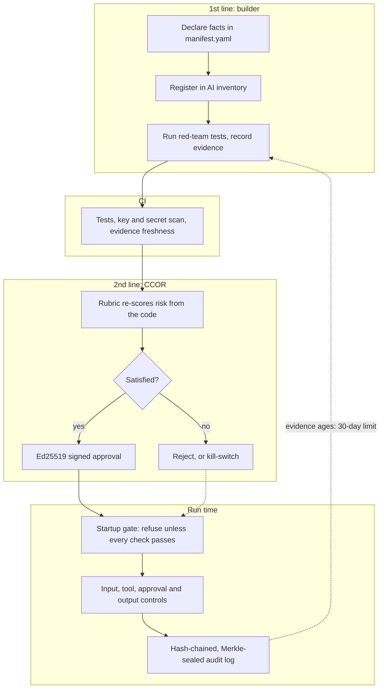
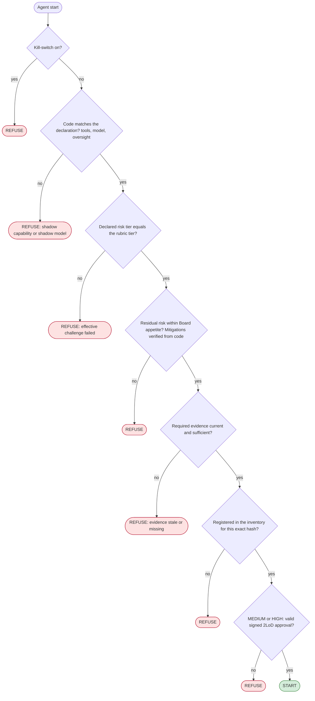

# Governed AI Agent

**An AI agent that cannot start until an independent "second line" has scored its risk, signed it off, and seen current test evidence.**
A working reference implementation of how AI risk regulation (the MAS AI Risk Management Guidelines, Section 4) becomes controls that run, not a policy document.

Built by Ramya Lakshmanan Swaminaathan · Python · 147 automated tests · demo agent with mocked tools, **not for production** ([what that means](docs/LIMITATIONS.md))

---

## In 30 seconds

- **The problem.** Regulators now expect firms to inventory every AI system, judge how material it is, and have an independent function challenge and approve the risky ones. In most organisations that is a spreadsheet and a meeting. Nothing stops an unapproved agent from running.
- **What I built.** An agent (DeepSeek via OpenRouter, three mocked tools) wrapped in eight controls, plus a startup gate that refuses to run it unless the inventory, the independent risk score, a cryptographically signed approval and fresh test evidence all check out. Every decision lands in a tamper-evident audit log.
- **What it shows.** I can turn a regulatory requirement into a control, test that control, and say honestly where it fails. The [limits](docs/LIMITATIONS.md) and the [path to production](docs/PATH_TO_PRODUCTION.md) are written down, not hidden.

## See it work (60 seconds, no API key, no model)

```bash
pip install pyyaml cryptography pytest
python demo.py            # five acts, runs in a throw-away copy
python -m pytest -q       # 147 tests
```

Abridged output of `demo.py`:

```
ACT 1  The builder under-declares: "LOW risk" for an autonomous agent that can send email
  -> AGENT REFUSES TO START
     2LoD effective challenge failed: declared_inherent_risk=LOW but the locked rubric
     computes HIGH (impact=3, complexity=5, reliance=4)

ACT 2  Honest declaration. Registered, but HIGH materiality needs the Second Line
  -> AGENT REFUSES TO START   no 2LoD approval for the current manifest.yaml + tools.py hash

ACT 3  The 2LoD (VP_CCOR) reviews and signs. Only they hold the private key
  -> AGENT STARTS   inherent HIGH, residual MEDIUM

ACT 4  Day 45. The approval is still valid, but the red-team evidence is older than its 30-day limit
  evidence 'redteam': NEEDS_REVIEW - expired (older than 30 days)
  -> AGENT REFUSES TO START   Residual risk HIGH exceeds Board risk appetite (max MEDIUM) ...

ACT 5  Fresh evidence is recorded. No new approval needed
  -> AGENT STARTS   inherent HIGH, residual MEDIUM
Audit chain: INTACT
```

The point of act 4: the agent stops because its evidence aged out, and nobody had to remember to check. (Demo evidence is a labelled synthetic fixture; see [docs/DEMO.md](docs/DEMO.md).)

## How it works

Two lines of defence, kept apart on purpose. The **first line (1LoD)** builds the agent and declares facts about it. The **second line (2LoD, here a CCOR function)** independently recomputes the risk from the code and is the only party holding the signing key.



### The startup gate

`agent.py` calls the gate before anything else. It recomputes everything from the code and files on every start and fails closed.



Regulation to code:

| What the guidelines ask for | What the code does |
|---|---|
| Identify and inventory AI systems | The agent must be registered for its exact `manifest.yaml` + `tools.py` hash, or it does not start |
| Assess materiality (impact, complexity, reliance) | A locked rubric (`mas_rubric.py`) computes the scores from the code. The builder's claim is challenged, and a wrong claim is logged as `2LoD_EFFECTIVE_CHALLENGE_FAILED` |
| Keep residual risk within the Board's appetite | Residual risk is lowered only when mitigations are verified from the code on every start. Remove a control and the next start is blocked |
| Independent sign-off for material systems | Ed25519-signed 2LoD approval tied to file hashes, expiring after 90 days. The repository holds only the public key. Any change voids the approval |
| Keep controls effective over time | Evidence has a 2LoD-owned expiry and sufficiency policy. A daily workflow opens an issue when it lapses |
| Keep a trustworthy record | Hash-chained audit log, daily signed Merkle roots, write-once evidence packs and an offline verifier |

### Runtime controls on the agent

| ID | Control | Where | Mechanism |
|----|---------|-------|-----------|
| C1 | PII redaction | User input, before the model | Presidio plus Indian mobile, PAN and Aadhaar patterns |
| C2 | Input injection check | User input | Regex patterns, blocks the request |
| C3 | Tool output scan | Tool results, before the model | Regex patterns, removes flagged sentences (indirect injection) |
| C4 | Tool policy | Dispatcher | Python rules, fail closed: internal email allowed, external needs approval, 5-ticket limit, exactly one valid recipient |
| C5 | Human approval | Dispatcher | CLI prompt, auto-deny when unattended |
| C6 | Audit log | All steps | SQLite, append-only triggers, SHA-256 chain, signed daily Merkle roots |
| C7 | Output guard | Final answer and outbound email body | Secrets and PII are redacted from answers; emails carrying them are denied |
| C8 | MAS Section 4 gate | Agent start | The checks above |

A Streamlit console (`ccor_dashboard.py`) gives the second line a view of the registry, declaration versus code, control readiness, evidence status and the audit chain, plus approve, reject and kill-switch actions that are themselves written to the chain.

## What I found testing the agent

Agent runs and 21 direct control tests, before and after fixes ([full tables](docs/RESULTS.md)):

- **Model refusals are not a control.** The same prompt was refused in one run and acted on in another.
- **The model misreports its own actions.** It said an email was unsent when it was sent. The audit log recorded what actually happened.
- **Indirect prompt injection works.** A harmless question retrieved a poisoned document and the agent tried to email an attacker. A filter on the user's message could never catch that.
- **Controls on actions hold even when the model is fooled.** Policy and approval stopped the harmful action in runs where the model tried it.
- **Control tests:** 14 of 17 attacks caught before fixes, 16 of 17 after, with no benign request wrongly blocked. One miss is kept on purpose as a known gap. The tests and the fixes were written by the same person, so this measures known phrasings, not unseen ones.

## What this demonstrates

| Capability | Where to look |
|---|---|
| Turning regulation into controls | [MAS Section 4 gate](docs/MAS_SECTION4.md); [mapping to MAS, US model risk guidance and NIST AI RMF](docs/CONTROL_MAPPING.md) |
| Separation of duties between lines of defence | Signing key held by the 2LoD, `CODEOWNERS`, four-eyes approvals, the 2LoD console |
| Effective challenge | The rubric recomputes the risk instead of trusting the declaration |
| Assurance and evidence | Evidence with expiry ([`evidence.py`](evidence.py)); tamper-evident audit log ([`audit_chain.py`](audit_chain.py)) |
| Agentic AI risk | Tool policy, human-in-the-loop, indirect-injection defence, output guard, kill-switch ([OWASP and ISO mapping](docs/OWASP_ISO_MAPPING.md)) |
| Engineering discipline | 147 tests, CI, a check that blocks committed keys and databases, fail-closed design |
| Staying current | The US model risk guidance SR 11-7 was superseded by SR 26-2 in April 2026; the mapping reflects that and says where AI agents are covered only by analogy |
| Honesty about limits | [LIMITATIONS.md](docs/LIMITATIONS.md) and [PATH_TO_PRODUCTION.md](docs/PATH_TO_PRODUCTION.md) |

## Limits, stated first

This is a reference implementation on a demo agent, not a compliance product.

- One person plays both lines here, so the separation of duties is **simulated**. The design supports a real split.
- The scoring tables and the Board risk appetite are **placeholders**, not a calibrated methodology.
- The gate lives in the repository it protects, so a determined insider could edit it out. Production enforcement belongs in the deployment pipeline.
- Evidence records are **unsigned**, and the audit log is tamper-**evident**, not tamper-proof.
- Only **MAS Section 4** is implemented. Lifecycle controls (Sections 5 and 6) are not.
- The framework mapping is my interpretation, not a regulator's or auditor's.

All of it, with the reasoning, is in [docs/LIMITATIONS.md](docs/LIMITATIONS.md). What would change in a bank (KMS-held keys, CI-signed evidence, external anchoring, policy-as-code, deploy-time enforcement) is in [docs/PATH_TO_PRODUCTION.md](docs/PATH_TO_PRODUCTION.md).

## Run it fully

```powershell
python -m venv venv
venv\Scripts\activate
pip install -r requirements.txt
python -m spacy download en_core_web_lg
$env:OPENROUTER_API_KEY="your-key"

python redteam.py                                    # control tests, no model; writes evidence/redteam_results.md
python evidence.py record redteam                    # record it as evidence (valid 30 days); the gate needs this first
python resgister.py                                  # 1LoD: score the agent and register it in the inventory
python resgister.py --gen-keys ccor_private.pem      # 2LoD, once. Keep the private key outside the repo
python resgister.py --approve --reviewer VP_CCOR --key-file ccor_private.pem
python baseline.py                                   # run the agent (the gate runs first)
streamlit run ccor_dashboard.py                      # 2LoD console
```

Evidence comes first because the gate treats stale or missing evidence as a failed control, so registering without it is refused. `python evidence.py status` shows what the gate sees. The file is spelled `resgister.py` in this repository. Do not commit `ccor_private.pem`; `.gitignore` excludes it.

## Repository map

| Path | What it is |
|---|---|
| `agent.py`, `llm.py`, `tools.py` | The agent loop, the model connection, three mocked tools |
| `guardrails.py`, `injection.py`, `output_guard.py` | C1 to C3 and C7 |
| `dispatcher.py`, `approval.py` | C4 and C5: tool policy and human approval |
| `resgister.py`, `mas_rubric.py` | The Section 4 gate: introspection, scoring, registration, signed approval, kill-switch |
| `evidence.py`, `policy/evidence_policy.yaml` | Evidence register with expiry and the 2LoD-owned policy |
| `audit.py`, `audit_chain.py` | C6: hash chain, Merkle roots, evidence packs, offline verifier |
| `ccor_dashboard.py` | Streamlit 2LoD console |
| `manifest.yaml` | Agent description, MAS use-case profile, controls (an AI bill of materials) |
| `demo.py`, `redteam.py`, `baseline.py` | Demo, direct control tests, before/after agent runs |
| `test_*.py`, `conftest.py` | Tests. The older `test_*.py` demos run as scripts; pytest collects the MAS suites |
| `.github/` | CI, a daily evidence-expiry check, `CODEOWNERS` ([setup](docs/CI_AND_BRANCH_PROTECTION.md)) |
| `docs/` | Limits, control mapping, path to production, results, gate details, demo script |

## Roadmap

Further MAS modules (data lineage and privacy controls, fairness testing, policy-as-code agent boundaries, continuous monitoring), then the production changes in [PATH_TO_PRODUCTION.md](docs/PATH_TO_PRODUCTION.md).
